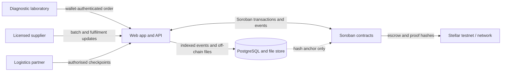

# MediChain

MediChain is an open-source coordination and settlement protocol for diagnostic laboratories, licensed suppliers, and logistics partners moving selected temperature-sensitive diagnostic reagents and test kits in Lagos. It is not a pharmaceutical distributor. Suppliers retain ownership of stock until the agreed transfer point.

The initial product coordinates availability, orders, escrow, delivery checkpoints, temperature evidence, and proof of condition on arrival. It does not include vaccines or general medicines.

> **Security warning: not audited, testnet only.** The planned Soroban contracts are unaudited. This repository is an early scaffold; do not use it with real funds or for production medical supply decisions. No mainnet deployment is supported.

## Architecture

Soroban is the trust and settlement layer for participant roles, attestations, batch and order state, escrow, and immutable proof hashes. Personal data, patient data, detailed temperature logs, and commercially sensitive pricing stay off-chain. The application database indexes chain events and stores permitted off-chain files; it is a cache and file store, not the source of truth for on-chain state or payments.



### Order state machine

```mermaid
stateDiagram-v2
  [*] --> Placed
  Placed --> Accepted
  Placed --> Cancelled: timeout or allowed cancellation
  Accepted --> Packed
  Accepted --> Cancelled: timeout or allowed cancellation
  Packed --> InTransit
  InTransit --> Delivered
  Delivered --> Confirmed: condition verified; no unresolved excursion
  Delivered --> Disputed: condition or quantity contested
  InTransit --> Disputed: excursion or delivery dispute
  Disputed --> Confirmed: arbiter resolves for release
  Disputed --> Cancelled: arbiter resolves for refund or cancellation
  Confirmed --> [*]
  Cancelled --> [*]
```



The diagram is a target design, not an implemented contract guarantee. Precise transition rules and timeout behavior will be documented and tested with the relevant contract stages.

## Repository status

This first contribution stage establishes documentation, repository conventions, and CI/security scaffolding. Contract, SDK, API, and frontend code are not implemented yet. See [the roadmap](docs/roadmap.md) and [contributor backlog](docs/issues/) as those are added.

## Quickstart

At this stage there is no runnable application or local Stellar network configuration yet. To inspect the scaffold:

```sh
git clone https://github.com/thaiwoz02/medichain-stellar.git
cd medichain-stellar
cp .env.example .env
```

Do not put real secrets in `.env`; it is ignored by Git. The actual local development, test, and deployment commands will be added alongside the relevant components. Testnet deployment addresses will be published here only after contracts are implemented and deployed:

- Network: Stellar testnet (planned)
- Soroban RPC: `TBD`
- Contract addresses: `TBD`
- Test USDC asset: `TBD`

## Planned repository layout

- `contracts/` — Rust/Soroban protocol contracts and integration tests
- `packages/sdk/` — TypeScript SDK generated bindings and client helpers
- `apps/api/` — NestJS API, PostgreSQL/Prisma indexer, and authorised log ingestion
- `apps/web/` — Next.js user and administration interface
- `docs/` — architecture, threat model, regulatory notes, roadmap, and contributor work
- `scripts/` — testnet deployment and demonstration scripts

## Security

Read [SECURITY.md](SECURITY.md) before reporting a vulnerability. The protocol trusts authorised attestors rather than raw sensor devices, and the contracts are **unaudited and testnet-only**. See the [threat model](docs/threat-model.md) for assumptions and risks.

## Contributing

Contributions are welcome after reviewing [CONTRIBUTING.md](CONTRIBUTING.md), the [Code of Conduct](CODE_OF_CONDUCT.md), and the project documentation. Work is being delivered incrementally; please keep changes scoped to the current stage and open an issue or discussion before proposing a major design change.

## License

MediChain is released under the [MIT License](LICENSE).
