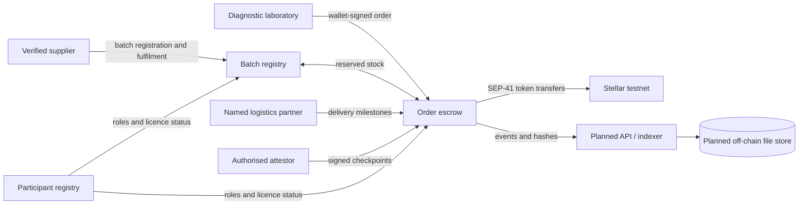

# MediChain

MediChain is an open-source coordination and settlement protocol for diagnostic laboratories, licensed suppliers, and logistics partners moving selected temperature-sensitive diagnostic reagents and test kits in Lagos. It is not a pharmaceutical distributor. Suppliers retain ownership of stock until the agreed transfer point.

The current implementation is deliberately limited to three Soroban contracts: participant verification, batch inventory, and order escrow with delivery checkpoints and condition proofs. The TypeScript SDK, API/indexer, web application, fees, subscriptions, and reputation are planned contributor work and are not implemented.

> **Security warning: unaudited, testnet only.** Do not use real funds, production medical shipments, or these contracts as the sole basis for regulated supply decisions. No mainnet deployment is supported.

## Architecture

Soroban is the source of truth for participant roles and attestations, registered batches and reserved inventory, order state, escrow and settlement, checkpoints, and proof hashes. Detailed temperature logs, patient or personal data, and off-chain files are not stored by these contracts. Order amounts, participant addresses, batch identifiers, and checkpoint summaries are public on-chain data.



### Order state machine

```mermaid
stateDiagram-v2
  [*] --> Placed: Lab creates and funds
  Placed --> Accepted: Supplier
  Placed --> Cancelled: Lab cancel or 48h timeout
  Accepted --> Packed: Supplier
  Accepted --> Cancelled: 7d delivery timeout
  Packed --> InTransit: Carrier
  Packed --> Cancelled: 7d delivery timeout
  InTransit --> Delivered: Carrier
  InTransit --> Cancelled: 7d delivery timeout
  Accepted --> Disputed: Lab, supplier, or carrier
  Packed --> Disputed: Lab, supplier, or carrier
  InTransit --> Disputed: Lab, supplier, or carrier
  Delivered --> Confirmed: Lab; acceptable proof, no unresolved excursion
  Delivered --> Disputed: Lab, supplier, or carrier
  Delivered --> Cancelled: 72h confirmation timeout, no unresolved excursion
  Disputed --> Resolved: Arbiter split payout
  Confirmed --> [*]
  Resolved --> [*]
  Cancelled --> [*]
```



An excursion is an independent flag: an arbiter may clear it as acceptable or move the order into `Disputed`. Normal lab confirmation is blocked while an excursion remains unresolved. Exact actors, timeout rules, and stock/funds behavior are in the [contract documentation](contracts/README.md#order-escrow) and [architecture notes](docs/architecture.md#implemented-order-transitions).

## Implemented and planned

- **Implemented:** `contracts/participant_registry`, `contracts/product_batch_registry`, and `contracts/order_escrow`, with Soroban unit/integration tests and a testnet deployment script.
- **Planned:** `packages/sdk`, `apps/api` and event indexer, `apps/web`, off-chain evidence storage, fees, subscriptions, and reputation. These are not part of the current stage.

The contract workspace bounds individual records and per-order checkpoints, imposes lifetime enrollment/order caps, avoids unbounded scans, and extends storage TTLs on access. Those measures do not remove storage-archival or key-management risks; see the [threat model](docs/threat-model.md).

## Local contract checks

Use the pinned Rust toolchain and run these commands from the repository root:

```sh
cargo fmt --manifest-path contracts/Cargo.toml --all -- --check
cargo clippy --manifest-path contracts/Cargo.toml --workspace --all-targets -- -D warnings
cargo test --manifest-path contracts/Cargo.toml --workspace
stellar contract build --manifest-path contracts/Cargo.toml --locked
```

The workspace pins `soroban-sdk` and records the exact Stellar CLI version used for the tested Wasm build in [`scripts/stellar-cli-version`](scripts/stellar-cli-version). Local build and test do not deploy contracts or contact testnet.

## Testnet deployment

`scripts/deploy-testnet.sh` is a separate, explicit operation. It needs the pinned Stellar CLI, existing funded CLI identities (provided through environment variables), and access to Stellar testnet. It submits public transactions and saves only public contract and test-asset IDs in the ignored local file `testnet-addresses.env`; never provide seed phrases or secret keys in this repository.

No testnet deployment was run for this stage. There are no verified deployment addresses to publish:

- Network: Stellar testnet (not deployed)
- Soroban RPC: `TBD`
- Contract addresses: `TBD`
- Test credit asset: `TBD`

## Security and regulatory boundaries

Read [SECURITY.md](SECURITY.md) before reporting a vulnerability. The chain trusts authorised verifiers and attestors, not raw sensors; a hash is not proof that a licence or shipment is genuine. Protocol records do not replace applicable NAFDAC/PCN compliance, operational controls, or legal advice. The [threat model](docs/threat-model.md) records reviewed safeguards and known limitations.

## Contributing

Review [CONTRIBUTING.md](CONTRIBUTING.md), the [Code of Conduct](CODE_OF_CONDUCT.md), and the staged [roadmap](docs/roadmap.md). Keep contributions scoped to the current stage and open an issue before proposing a major design change.

## License

MediChain is released under the [MIT License](LICENSE).
