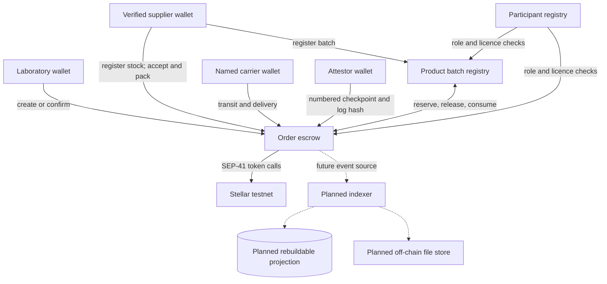

# Architecture

## Implementation status

The implemented stage contains only three Soroban contracts: `participant_registry`, `product_batch_registry`, and `order_escrow`. There is no SDK, API, event indexer, web client, off-chain evidence store, fee model, subscription feature, or reputation system yet. The testnet deployment script is present but has not been run. This document describes the contracts as built and clearly labels later components as planned.

## Design principles

1. **Soroban is the source of truth** for roles and attestations, batch inventory, order transitions, escrow settlement, checkpoints, and proof anchors.
2. **Keep sensitive and bulky evidence off-chain.** The contracts store hashes and bounded checkpoint summaries rather than detailed temperature logs or personal/patient data. No off-chain store is implemented yet.
3. **Authorization is enforced by contracts.** A future UI or API cannot substitute for `require_auth` and contract role checks.
4. **The protocol coordinates; it does not distribute.** Licensed suppliers remain responsible for regulated distribution and custody until the agreed transfer point.
5. **Use testnet until independently reviewed.** Contracts are unaudited, and no production or mainnet use is supported.

## Implemented contracts

- **Participant registry:** one role per Stellar address (`Lab`, `Supplier`, `Logistics`, or `Attestor`); separate verifier-issued licence document hash, expiry, and revocation; admin/verifier separation; two-step admin transfer. Current verifier and role/verification queries are public.
- **Product batch registry:** a verified supplier registers a unique, at-most-64-byte batch ID, product-specification hash, storage range in tenths of °C, expiry, and quantity. Fulfilability checks current supplier verification, expiry, valid range, and sufficient nonzero requested quantity. Only the configured order escrow can reserve, release, or finalize stock.
- **Order escrow:** a registered lab creates and funds a batch order through the SEP-41 token interface. Supplier/carrier role checks govern fulfilment milestones. An authorised attestor submits bounded numbered checkpoints; the delivery proof is immutable; an arbiter resolves excursions and disputes. Refund and payout paths update terminal state before external calls and rely on Soroban transaction atomicity.

Each contract requires authorization for state-changing actor functions, uses checked arithmetic for quantities and payouts, emits events for state changes, and avoids collection scans. Lifetime caps are 10,000 participant registrations, 10,000 batch registrations, and 100,000 orders; each order has at most 64 checkpoints. Batch IDs are limited to 64 bytes. These limits bound protocol-controlled record growth but do not replace ledger resource planning.

## Planned components

- **SDK:** typed clients and transaction helpers for downstream applications.
- **API/indexer:** wallet-session authentication, event indexing, and a rebuildable PostgreSQL projection. It is not implemented; it must not impersonate participants.
- **Evidence store:** controlled off-chain storage for detailed files. It is not implemented; only bounded hashes are currently anchored on-chain.
- **Web client:** wallet-based order, shipment, and proof interface. Not implemented.
- **Fees, subscriptions, and reputation:** explicitly deferred. No fee or recurring-debit path exists, and no reputation score is computed.

## Trust and data flow

The contract calls verify signer authorization, participant roles, and configured contract addresses; they do not authenticate HTTP users. The API and indexer do not exist yet. A future relayer may submit a transaction only when the required actor authorization is present. A service key must not be treated as authority to impersonate a participant.

## Data boundaries

| Information | Current representation | Visibility / limitation |
|---|---|---|
| Stellar addresses and participant roles | Soroban persistent records | Public ledger data |
| Verifier attestation | 32-byte document hash, expiry and revoked flag | Hash does not establish the underlying licence's authenticity |
| Product specifications and supporting documents | Not stored by these contracts | A product-specification hash is on-chain; source document storage is future work |
| Batch ID, expiry, quantity and storage range | Bounded Soroban batch record | Public; IDs are limited to 64 bytes |
| Detailed sensor and temperature logs | Not stored by these contracts | Checkpoint summaries and 32-byte log hashes are public; detailed log handling is future work |
| Patient or personal data | Not required or stored by the contracts | Do not put it in public ledger fields or unsalted, guessable hashes |
| Payment asset, amount, counterparties | Order escrow record and token transfers | Public ledger data; no confidentiality is provided |
| Delivery proof | Quantity, condition code, log hash, lab, timestamp | Public, immutable after successful confirmation |
| Orders, disputes, checkpoints | Soroban records and events | Public; each order is limited to 64 checkpoints |

A public chain cannot hide addresses or transfer amounts. The pilot must account for that limitation before any real counterparties or shipments are considered.

## Implemented order transitions

`Created` is an event-only pre-state: the stored order begins in `Placed`. The state-changing function and contract authorization define each edge. A timeout is permissionless in policy—any address may submit it—but that caller address must authorize the transaction.

| From → To | Trigger and required actor | Conditions / settlement |
|---|---|---|
| `Created → Placed` | `create_order`; registered Lab | Batch must be fulfillable for the quantity; supplier and carrier roles must be eligible; lab funds escrow; stock is reserved. |
| `Placed → Accepted` | `accept`; named Supplier | Supplier address must match the order. |
| `Accepted → Packed` | `mark_packed`; named Supplier | No additional payment. |
| `Packed → InTransit` | `mark_in_transit`; named Carrier | Carrier address must match the order. |
| `InTransit → Delivered` | `mark_delivered`; named Carrier | Records delivery time. |
| `Delivered → Confirmed` | `confirm_delivery`; named Lab | Full quantity and `Acceptable` condition required; unresolved excursion blocks confirmation; immutable proof is stored and the supplier is paid. |
| `Placed → Cancelled` | `cancel_before_acceptance`; named Lab | Refunds the Lab and releases reserved quantity. |
| `Placed → Cancelled` | `timeout_order`; any signing caller after 48 hours from creation | Refunds the Lab and releases reserved quantity. |
| `Accepted`, `Packed`, or `InTransit → Cancelled` | `timeout_order`; any signing caller after 7 days from acceptance | Refunds the Lab and releases reserved quantity. |
| `Delivered → Cancelled` | `timeout_order`; any signing caller after 72 hours from delivery | Allowed only with no unresolved excursion; refunds the Lab and releases reserved quantity. |
| `Accepted`, `Packed`, `InTransit`, or `Delivered → Disputed` | `raise_dispute`; Lab, named Supplier, or named Carrier | Stops ordinary confirmation; no automatic payout. |
| `Disputed → Resolved` | `resolve_dispute`; configured Arbiter | Supplier receives the selected 0–10,000 basis-point share; remainder is refunded to the Lab. Zero supplier share releases inventory; a nonzero share finalizes reserved inventory. |

`submit_checkpoint` is allowed while `Accepted`, `Packed`, `InTransit`, or `Delivered`; it does not itself change the order state. It requires the signer to have the `Attestor` role, the next exact sequence, a nondecreasing non-future timestamp, and observed minimum ≤ maximum. A reading outside the batch storage range raises `excursion_unresolved`. The configured Arbiter can clear an excursion as acceptable without changing state or mark it unacceptable, moving the order to `Disputed` unless it was already disputed. `Confirmed`, `Resolved`, and `Cancelled` are terminal. Repeated transition or payout calls fail rather than pay twice.

## Storage and TTL

Persistent entries extend from a 100,000-ledger threshold to 500,000 ledgers on access. Instance entries use the same threshold and extension target. Storage values have fixed-size hashes/addresses and bounded batch IDs/checkpoints; no function scans an unbounded collection. The contracts do not implement an archival restore workflow: a record left untouched long enough may be archived under network TTL rules. Disputed orders have no automatic timeout, so a long-idle record or unavailable arbiter can leave settlement operationally stuck; both are known limitations requiring monitoring and an explicit maintenance/recovery design before production.

## Operational model

The supplied script targets Stellar testnet and a newly issued test credit asset. It requires existing CLI identities and funding, sends public transactions, and writes only public contract/token IDs to an ignored local file. The script has not been run against testnet. The README therefore leaves RPC and contract addresses as `TBD`; no deployment result is implied by a local Wasm build. Before any production use, independent contract, operational, key-management, and regulatory review is required.
