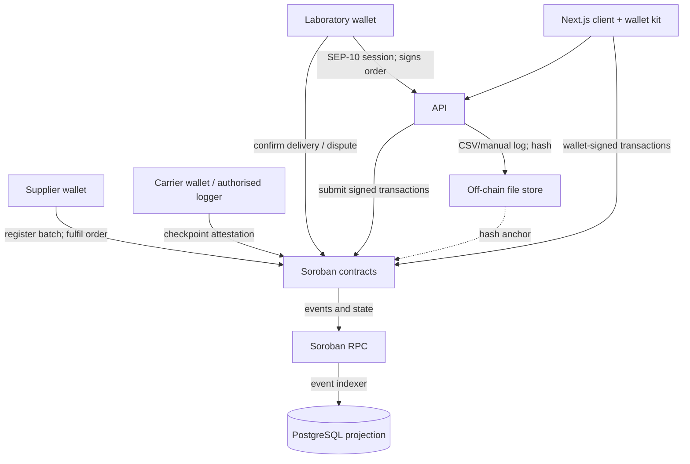

# Architecture

## Status

This document describes the intended first release. At Stage 1, no contracts or app services are implemented. Diagrams and workflows are design targets, not security guarantees.

## Design principles

1. **Soroban is the source of truth** for verified roles, protocol rules, batch/order transitions, escrow balances, and proof anchors.
2. **Keep sensitive and bulky data off-chain.** Do not put patient or personal data, detailed temperature logs, or commercially sensitive pricing on the ledger. Store permitted data off-chain and anchor it by a cryptographic hash where useful.
3. **Authorization is enforced by contracts.** UI and API checks are usability controls and do not substitute for `require_auth` and contract-level role checks.
4. **The protocol coordinates; it does not distribute.** Licensed suppliers remain responsible for regulated distribution and custody until the agreed transfer point.
5. **Use testnet until independently reviewed.** Test tokens, demo data, and deployment scripts must be clearly identified as non-production.

## Components

- **Participant registry:** lab, supplier, and carrier roles; verifier attestations with document hashes and expiry; revocation and expiry checks.
- **Product/batch registry:** product-specification hash, batch identifier, expiry, storage range in tenths of a degree Celsius, and available/reserved quantity. Fulfilability depends on current supplier verification and batch validity.
- **Order escrow:** order state, payment asset and amount, supplier/carrier split, deadlines, cancellation/dispute resolution, and payout/refund conditions.
- **Cold-chain attestation:** authorised checkpoint records containing shipment reference, timestamp, observed min/max temperatures, and a hash of the underlying log. Readings outside batch limits flag an excursion and block ordinary release until resolved.
- **Proof of condition:** receiving lab's signed delivery record and hash anchor for quantity, condition, and the relevant temperature record.
- **Fee and subscription:** capped protocol fee configuration and, if implemented, explicit recurring-style authorisation. Subscription behavior must not imply an unbounded standing debit.
- **Reputation:** bounded counters for completions, excursions, and disputes lost; informational only and never a substitute for verification.
- **API and PostgreSQL:** wallet/SEP-10 authentication, event indexing from Soroban RPC, and controlled ingestion of log metadata or files. Database records are rebuildable projections, not authoritative settlement state.
- **Web client and SDK:** wallet-based interactions, shipment timeline and proofs, and typed third-party access to generated contract bindings.

## Trust and data flow

The API may submit a transaction on behalf of an authorised actor only when the actor's required authorization is actually present. An API service key must not be able to impersonate a participant.

## Key data boundaries

| Information | Intended location | On-chain representation |
|---|---|---|
| Stellar addresses, roles, verifier attestations | Soroban | Address, role, document hash, validity/revocation state |
| Product specification and supporting licence documents | Off-chain controlled storage | Hash and applicable expiry/role state only |
| Batch identifiers, expiry, quantity and storage limits | Soroban | Bounded metadata required for fulfilment and checks |
| Patient or personal data | Not required by the protocol | None |
| Detailed sensor/temperature records | Off-chain storage | Log hash and authorised checkpoint summary |
| Sensitive negotiated pricing | Off-chain or transaction-specific private process | Never a public catalogue price; escrow amounts are visible on a public ledger |
| Order, escrow, dispute, and proof state | Soroban | State, payment, and minimal proof hashes |

Because Stellar ledger data is public, transaction amounts and addresses are visible even if private catalogue prices are not stored as protocol metadata. The pilot must account for that limitation before using real counterparties.

## State transition intent

Orders are intended to progress through `Placed → Accepted → Packed → InTransit → Delivered → Confirmed`. A participant may raise a dispute when the delivery, quantity, or condition is contested; an excursion blocks normal release until a defined resolution is made. Timeouts and cancellation must be explicit, deterministic, and covered by tests. Only an authorised arbiter may resolve a dispute, and settlement must be safe if a transition is attempted repeatedly.

See the overview state machine in the [README](../README.md). Exact actors, deadlines, partial payout rules, and refund behavior remain to be specified and tested during contract implementation.

## Operational model

The intended first pilot uses Stellar testnet and a test asset. Contract identifiers, RPC details, deployment procedure, admin/verifier key custody, and local quickstart instructions will be documented with the implementation. The event indexer must handle reorg/finality assumptions, retries, duplicate events, and resynchronisation without creating false state transitions.
